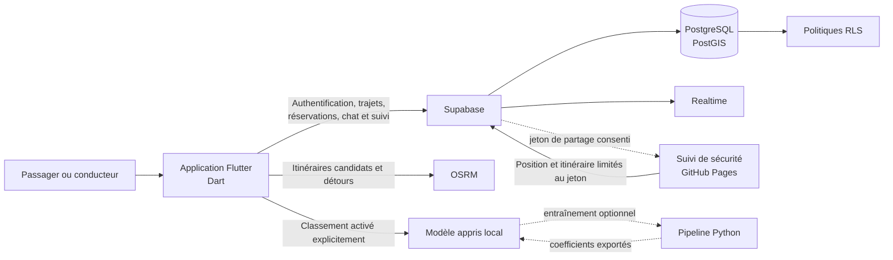

<p align="center">
  
</p>

# AlonzY

**Le covoiturage urbain et interurbain, pensé pour les déplacements au Canada.**

[English](README.md) · [Français](README.fr.md)

AlonzY met en relation passagers et conducteurs grâce à la recherche
géolocalisée, à l’estimation transparente des détours et au partage de trajet
conçu pour protéger la vie privée. Son application Flutter modulaire s’appuie
sur Supabase et sur des services de routage et d’appariement évolutifs.

> **État du projet :** plateforme open source en développement actif. Consultez
> les notes de déploiement et de confidentialité avant de l’utiliser pour de
> vrais trajets ou avec des renseignements personnels.

## Fonctionnalités phares

- **Recherche géospatiale :** PostGIS filtre les trajets disponibles selon le
  rayon de départ, la date, les places et le prix.
- **Appariement routier :** OSRM évalue le détour des trajets présélectionnés;
  les règles déterministes restent le classement par défaut.
- **Classement appris expérimental :** un modèle logistique transparent peut
  être activé explicitement. Les coefficients fournis ont été entraînés sur des
  données synthétiques et ne démontrent ni l’acceptation réelle ni les
  performances en production.
- **Suivi en direct :** le conducteur et les passagers confirmés peuvent suivre
  un trajet actif avec Supabase Realtime.
- **Lien de sécurité externe :** consentement explicite, expiration après
  trois heures et révocation immédiate. La conception tient compte des
  principes de protection pertinents à la **Loi 25 du Québec**; elle ne
  constitue pas une certification juridique de conformité.
- **Expérience bilingue :** les chaînes d’interface françaises et anglaises
  sont maintenues ensemble.
- **Cartographie extensible :** MapLibre est encapsulé derrière une abstraction
  de fournisseur, ce qui facilite son remplacement.

L’application utilise par défaut des services de cartographie et de routage
gratuits et ouverts. Le point de terminaison public de démonstration OSRM est
destiné à un usage léger en développement, sans garantie de production. Les
coordonnées d’itinéraire sont transmises au serveur OSRM configuré; choisissez
un point de terminaison adapté à votre déploiement.

## Architecture



PostGIS effectue la première sélection des trajets. OSRM estime ensuite la
distance et la durée routières des itinéraires présélectionnés. Le pipeline
Python optionnel entraîne et exporte les coefficients nommés d’une régression
logistique; l’inférence dans l’application s’exécute localement. Le suivi est
une page statique distincte et ne reçoit jamais de clé Supabase
`service_role`.

## Démarrage rapide

### Prérequis

- Flutter **3.41+** et Dart **3.11+**
- Un projet Supabase et la [CLI Supabase](https://supabase.com/docs/guides/cli)
- Python et `pip` pour les tests ou outils d’entraînement ML

### 1. Récupérer le code et configurer l’application

```sh
git clone https://github.com/AlphaSimpli/AlonzY.git
cd AlonzY
cp .env.example .env
```

Dans `.env`, indiquez l’URL du projet et la clé **publique anon/publishable**
de Supabase. Définissez `SAFETY_TRACKER_URL` vers la page de suivi déployée si
les liens de sécurité externes sont activés. N’inscrivez jamais de clé
Supabase `service_role` dans l’application ou dans ce fichier.

### 2. Appliquer les migrations

Utilisez un projet Supabase de développement, vérifiez les migrations SQL,
puis liez le projet et appliquez-les :

```sh
supabase login
supabase link --project-ref VOTRE_REFERENCE_PROJET
supabase db push --linked
```

Les migrations configurent le schéma, la recherche PostGIS, les flux de
réservation et d’appariement, les politiques de sécurité au niveau des lignes
(RLS) et les fonctions de partage de sécurité. N’appliquez pas de migration
non vérifiée à un projet de production.

### 3. Lancer l’application Flutter

```sh
flutter pub get
flutter run
```

L’accès à la localisation dépend des permissions de la plateforme et des
paramètres de l’appareil.

### 4. Exécuter les tests et outils ML facultatifs

```sh
flutter analyze
flutter test

python3 -m venv .venv-ml
source .venv-ml/bin/activate
python -m pip install -r ml/requirements.txt pytest
pytest -q
```

Par défaut, le script d’entraînement utilise des données synthétiques. Pour
exporter un modèle sans remplacer les coefficients fournis :

```sh
python ml/train_matching_model.py --output /tmp/alonzy-model.json
```

Pour les exports de retours réels, respectez le schéma CSV/JSON du script et
évaluez les exigences de confidentialité et de gouvernance des données avant
tout entraînement ou partage.

## Structure du dépôt

```text
lib/
  l10n/          Ressources et code généré pour le français et l’anglais
  maps/          Interfaces cartographiques et fournisseur MapLibre
  models/        Modèles typés de trajets, réservations, profils et appariement
  screens/       Écrans Flutter et parcours de trajet
  services/      Accès Supabase, routage, appariement et sécurité
  widgets/       Composants d’interface réutilisables
ml/              Pipeline Python et coefficients du modèle fourni
supabase/
  migrations/    Évolutions versionnées PostgreSQL, PostGIS, RLS et flux
test/            Tests de régression Flutter et Python
web_tracker/     Page statique de suivi de sécurité externe
docs/            Données de benchmark routier et références
```

## Feuille de route

Pistes envisagées, selon les retours de la communauté et la préparation
opérationnelle :

- Évaluer la qualité de l’appariement avec des retours représentatifs et
  consentis, séparés par passager, avant de changer le classement par défaut.
- Prendre en charge des points de terminaison de routage configurables et
  adaptés à la production, avec une meilleure observabilité.
- Développer l’accessibilité, la localisation et les parcours propres à chaque
  plateforme.
- Enrichir la documentation des contributions et les vérifications
  automatisées au fil de l’évolution du projet.

## Contribuer

Les problèmes et demandes de fusion sont les bienvenus. Avant une demande de
fusion, exécutez `dart format .`, `flutter analyze`, `flutter test` et
`pytest -q` si le code Python est concerné. Gardez les clés et paramètres des
traductions françaises et anglaises synchronisés, et ajoutez des tests ciblés
pour tout changement de comportement.

Pour signaler un problème de sécurité, consultez [SECURITY.md](SECURITY.md).
La [licence](LICENSE) précise les conditions de réutilisation et
[LIVE_SAFETY_TRACK.md](LIVE_SAFETY_TRACK.md) décrit le déploiement du suivi et
ses mesures de confidentialité.
