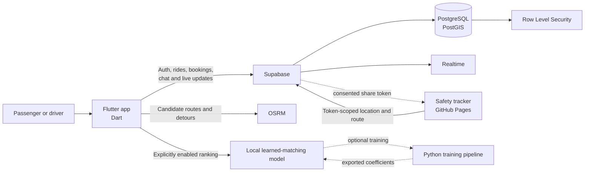

<p align="center">
  
</p>

# AlonzY

**Urban and intercity carpooling, designed for the way people move across Canada.**

[English](README.md) · [Français](README.fr.md)

AlonzY connects passengers and drivers through location-aware ride discovery,
transparent detour estimates, and privacy-conscious trip sharing. Its modular
Flutter client is backed by Supabase, with routing and matching services that
can evolve independently.

> **Project status:** an actively developed open-source platform. Review the
> deployment and privacy notes below before using it with real trips or
> personal data.

## Highlights

- **Geospatial discovery:** PostGIS narrows available rides by pickup radius,
  date, seats, and price.
- **Road-aware matching:** OSRM evaluates route detours for shortlisted rides;
  deterministic rules remain the default ranking.
- **Experimental learned ranking:** a transparent logistic model can be
  enabled explicitly. Its bundled coefficients are trained on synthetic data,
  so they are not evidence of real-world acceptance or production performance.
- **Live trip sharing:** the driver and confirmed passengers can follow an
  active trip with Supabase Realtime.
- **External safety link:** explicit consent, a three-hour expiry, and immediate
  revocation. The design supports privacy principles relevant to Québec's
  **Law 25**; it is not a legal compliance certification.
- **Bilingual experience:** French and English interface strings are maintained
  together.
- **Extensible maps:** MapLibre is behind a provider abstraction, keeping map
  implementations replaceable.

The application uses free/open map and routing services by default. OSRM's
public demo endpoint is intended for light development use, not a production
traffic commitment. Route coordinates are sent to the configured OSRM server;
choose an appropriate endpoint for your deployment.

## Architecture



PostGIS performs the first-stage candidate search. OSRM then supplies road
distance and duration estimates for the shortlisted routes. The optional
Python pipeline trains and exports named logistic-regression coefficients;
inference in the app is local. The tracker is a separate static page and never
receives a Supabase service-role key.

## Quickstart

### Prerequisites

- Flutter **3.41+** and Dart **3.11+**
- A Supabase project and the [Supabase CLI](https://supabase.com/docs/guides/cli)
- Python and `pip` for the matching-model tests or training tools

### 1. Get the code and configure the app

```sh
git clone https://github.com/AlphaSimpli/AlonzY.git
cd AlonzY
cp .env.example .env
```

Edit `.env` with the project URL and **public anon/publishable key** from
Supabase. Set `SAFETY_TRACKER_URL` to the deployed tracker page if external
safety links are enabled. Never put a Supabase service-role key in the app or
this file.

### 2. Apply database migrations

Use a development Supabase project, review the SQL migrations, then link and
apply them:

```sh
supabase login
supabase link --project-ref YOUR_PROJECT_REF
supabase db push --linked
```

The migrations configure the schema, PostGIS search, booking and matching
workflows, row-level security, and safety-sharing functions. Do not apply
unreviewed migrations to a production project.

### 3. Run the Flutter app

```sh
flutter pub get
flutter run
```

Location access depends on platform permissions and device settings.

### 4. Run tests and the optional ML tools

```sh
flutter analyze
flutter test

python3 -m venv .venv-ml
source .venv-ml/bin/activate
python -m pip install -r ml/requirements.txt pytest
pytest -q
```

The training script uses synthetic data by default. To export a model without
overwriting the bundled coefficients:

```sh
python ml/train_matching_model.py --output /tmp/alonzy-model.json
```

For real feedback exports, follow the script's CSV/JSON schema and review
privacy and data-governance requirements before training or sharing data.

## Repository map

```text
lib/
  l10n/          English/French resources and generated localization
  maps/          Provider-neutral map interfaces and MapLibre provider
  models/        Typed ride, booking, profile and matching models
  screens/       Flutter application screens and trip flows
  services/      Supabase access, routing, matching and safety services
  widgets/       Reusable interface components
ml/              Python training pipeline and bundled model coefficients
supabase/
  migrations/    Versioned PostgreSQL, PostGIS, RLS and workflow changes
test/            Flutter and Python regression tests
web_tracker/     Static external safety-tracking page
docs/            Routing benchmark data and supporting references
```

## Roadmap

Planned directions, subject to community feedback and operational readiness:

- Evaluate matching quality with consented, representative feedback and
  passenger-separated validation before changing the default ranking.
- Support configurable, production-grade routing endpoints and observability.
- Expand accessibility, localization, and platform-specific trip experiences.
- Improve contributor documentation and automated checks as the project grows.

## Contributing

Issues and pull requests are welcome. Before opening a pull request, run
`dart format .`, `flutter analyze`, `flutter test`, and `pytest -q` when Python
code is affected. Keep French and English localization keys and placeholders
in sync, and include focused tests for behavior changes.

For security-sensitive reports, see [SECURITY.md](SECURITY.md). See
[LICENSE](LICENSE) for reuse terms and [LIVE_SAFETY_TRACK.md](LIVE_SAFETY_TRACK.md)
for tracker deployment and privacy details.
